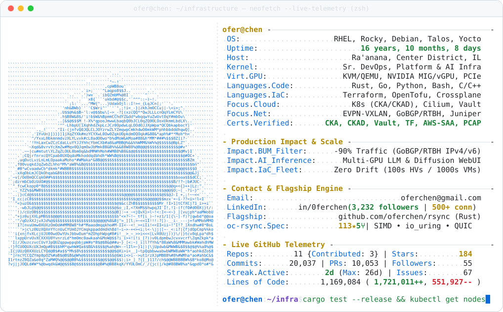

<a href="https://github.com/oferchen/rsync">
  <picture>
    <source media="(prefers-color-scheme: dark)" srcset="https://raw.githubusercontent.com/oferchen/oferchen/main/dark_mode.svg">
    
  </picture>
</a>

<a href="https://github.com/oferchen/rsync"><picture><source media="(prefers-color-scheme: dark)" srcset="https://raw.githubusercontent.com/oferchen/oferchen/main/link_portfolio_dark.svg"></picture></a><a href="https://www.linkedin.com/in/0ferchen/"><picture><source media="(prefers-color-scheme: dark)" srcset="https://raw.githubusercontent.com/oferchen/oferchen/main/link_linkedin_dark.svg"></picture></a><a href="mailto:oferchen@gmail.com"><picture><source media="(prefers-color-scheme: dark)" srcset="https://raw.githubusercontent.com/oferchen/oferchen/main/link_email_dark.svg"></picture></a>

<picture>
  <source media="(prefers-color-scheme: dark)" srcset="https://raw.githubusercontent.com/oferchen/oferchen/main/pacman_dark.svg">
  
</picture>

 

<!-- Live Ranking, Velocity & Ecosystem Badges -->

  

  
  
  
  

